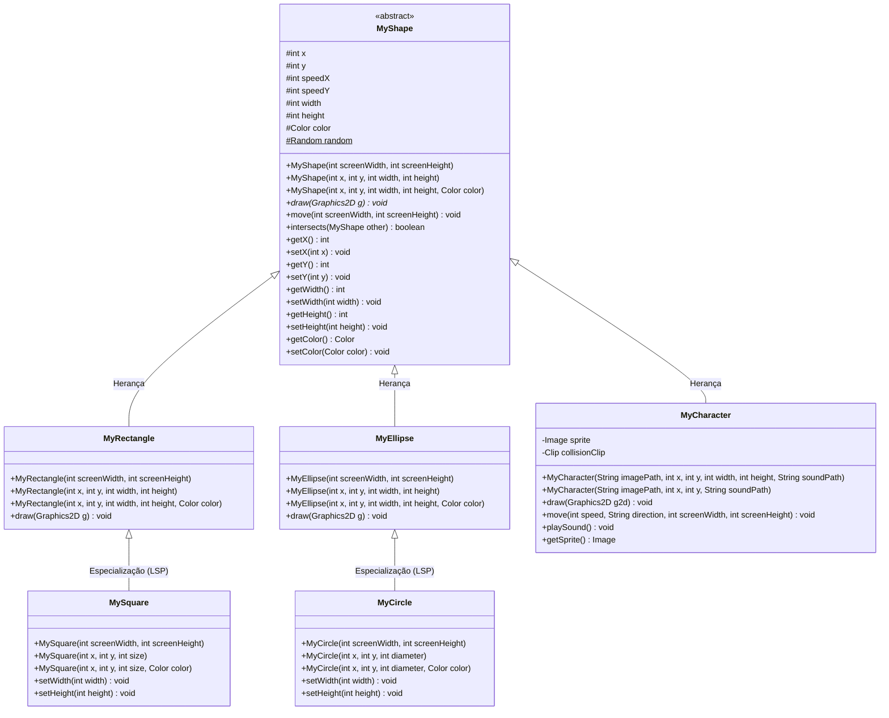

# ScreenSaver – Projeto Base para Programação Orientada a Objetos e Games 2D

## 🎯 Objetivo Didático

Este projeto foi desenvolvido como uma ferramenta prática e interativa para o aprendizado e consolidação dos quatro pilares da **Programação Orientada a Objetos (POO)**:

1. **Abstração**: Modelagem de entidades do mundo visual em classes abstratas e concretas (`MyShape`, `MyCharacter`).
2. **Encapsulamento**: Proteção e controle de acesso a atributos de posição, tamanho e velocidade por meio de modificadores e métodos acessores (*getters/setters*).
3. **Herança**: Reutilização de atributos e comportamentos comuns da superclasse `MyShape` em formas especializadas (`MyRectangle`, `MyEllipse`, `MyCharacter`).
4. **Polimorfismo**: Sobrescrita de métodos (`draw`, `setWidth`, `setHeight`) e tratamento genérico de múltiplos objetos através de uma coleção de tipos base (`List<MyShape>`).

Além do protetor de tela clássico, o projeto conta com suporte a **sprites de imagens**, **efeitos sonoros** e **detecção de colisão**, servindo de infraestrutura para que os alunos construam seus próprios jogos 2D (ex.: *Pong*, *Breakout*, *Snake*, *Space Shooter* ou *Coleta de Itens*).

---

## 🏗️ Estrutura de Diretórios

```text
04_ScreenSaverJava/
├── bin/                          # Bytecodes compilados (.class) e recursos
├── src/
│   ├── App.java                  # Ponto de entrada (Main e inicialização da GUI)
│   ├── image/
│   │   └── logo_unisenai.png     # Texturas e imagens dos personagens/jogos
│   ├── sound/
│   │   └── error.wav             # Efeitos sonoros de colisão e ações
│   ├── model/                    # Regras de negócio e entidades visuais
│   │   ├── MyShape.java          # Superclasse abstrata base
│   │   ├── MyRectangle.java      # Retângulo desenhável
│   │   ├── MySquare.java         # Quadrado (especialização de retângulo)
│   │   ├── MyEllipse.java        # Elipse desenhável
│   │   ├── MyCircle.java         # Círculo (especialização de elipse)
│   │   └── MyCharacter.java      # Personagem com imagem e som controlável
│   └── view/
│       └── ScreenSaver.java      # Janela Swing, Canvas (JPanel), Game Loop e Teclado
└── README.md
```

---

## 📊 Diagrama de Classes (Mermaid)

O diagrama abaixo ilustra a hierarquia de herança e os relacionamentos do pacote `model`:



---

## 🕹️ Funcionalidades e Recursos Implementados

### 1. Tela Cheia Imersiva (*Exclusive Borderless Fullscreen*)
A classe `ScreenSaver` inicializa sem bordas ocupando 100% da tela do monitor.
- **Como sair**: A qualquer momento, pressione a tecla **`ESC`** para fechar a aplicação imediatamente.

### 2. Controle do Personagem via Teclado
O personagem responde fluidamente a duas formas de controle simultâneas:
- **Setas direcionais**: `CIMA`, `BAIXO`, `ESQUERDA`, `DIREITA`.
- **Teclas Gamer (WASD)**: `W`, `S`, `A`, `D`.
- Permite **movimento diagonal** ao pressionar duas teclas ao mesmo tempo.

### 3. Sistema de Áudio Sem Travamentos
O áudio WAV é pré-carregado na memória (via classe `Clip` da Java Sound API) durante a inicialização do personagem.
- Ao colidir com as bordas da tela ou com outros elementos, o som é disparado suavemente, sem criar novas instâncias de conexão e sem gerar travamentos ou ruídos repetitivos.

### 4. Detecção de Colisão (`intersects`)
Todas as formas geométricas e o personagem herdam o método:
```java
if (shape.intersects(character)) {
    // Código de colisão (ex: som, pontuação, sumir da tela)
}
```
Esse teste baseia-se no algoritmo retangular de caixa delimitadora (*Bounding Box*), suficiente para a maioria dos jogos 2D.

### 5. Remoção Segura de Elementos da Tela
Ao implementar mecânicas onde formas somem ao serem atingidas, utilize o **laço reverso**:
```java
for (int i = shapes.size() - 1; i >= 0; i--) {
    MyShape shape = shapes.get(i);
    shape.move(screenWidth, screenHeight);

    if (character != null && shape.intersects(character)) {
        character.playSound();
        shapes.remove(i); // Remove pelo índice com segurança!
    }
}
```
> ⚠️ **Atenção pedagógica:** Não utilize `shapes.remove(shape)` dentro de um `for (MyShape s : shapes)` comum, pois o Java lançará `ConcurrentModificationException` e travará o timer.

---

## 🚀 Como Estender o Projeto para Criar seu Jogo

Os pontos de extensão estão demarcados em [`ScreenSaver.java`](./src/view/ScreenSaver.java):

### 1. Declaração das Entidades
```java
/*********************************
** ↓ Declare suas formas aqui ↓ **
*********************************/
private List<MyShape> obstaculos = new ArrayList<>();
private MyCharacter jogador;
private int pontuacao = 0;
```

### 2. Instanciação dos Elementos
Você pode instanciar formas tanto com dimensões aleatórias quanto em posições e tamanhos fixos:
```java
/***********************************
** ↓ Instancie suas formas aqui ↓ **
***********************************/
// Personagem com tamanho original da imagem:
jogador = new MyCharacter("image/logo_unisenai.png", 100, 100, "sound/error.wav");

// Ou com redimensionamento personalizado (ex: 80x80):
// jogador = new MyCharacter("image/logo_unisenai.png", 100, 100, 80, 80, "sound/error.wav");

// Formas em posições fixas (ótimo para tijolos, raquetes e obstáculos):
obstaculos.add(new MyRectangle(200, 50, 100, 30, Color.RED));
obstaculos.add(new MySquare(400, 150, 40, Color.YELLOW));
obstaculos.add(new MyCircle(500, 200, 50, Color.GREEN));
```

### 3. Atualização Lógica e Colisões (`actionPerformed`)
```java
/******************************
** ↓ Mova suas formas aqui ↓ **
******************************/
int largura = this.getWidth();
int altura = this.getHeight();

// Movimenta o jogador via teclado
if (up)    jogador.move(5, "UP", largura, altura);
if (down)  jogador.move(5, "DOWN", largura, altura);
if (left)  jogador.move(5, "LEFT", largura, altura);
if (right) jogador.move(5, "RIGHT", largura, altura);

// Atualiza obstáculos e checa colisões
for (int i = obstaculos.size() - 1; i >= 0; i--) {
    MyShape obj = obstaculos.get(i);
    obj.move(largura, altura);

    if (jogador.intersects(obj)) {
        jogador.playSound();
        obstaculos.remove(i);
        pontuacao += 10;
    }
}
```

### 4. Desenho e HUD na Tela (`paintComponent`)
```java
/*********************************
** ↓ Desenhe suas formas aqui ↓ **
*********************************/
for (MyShape obj : obstaculos) {
    obj.draw(g2d);
}

if (jogador != null) {
    jogador.draw(g2d);
}

// Desenhando placar na tela
g2d.setColor(Color.WHITE);
g2d.setFont(new Font("Arial", Font.BOLD, 20));
g2d.drawString("Pontuação: " + pontuacao, 30, 40);
```

---

## 🛠️ Compilação e Execução

### No VS Code ou Eclipse
Abra o projeto e pressione **F5** ou execute a classe [`App.java`](./src/App.java).

### Pelo Terminal / Prompt de Comando
```bash
# Compilar todas as classes para a pasta bin
javac -d bin -cp src src/App.java src/model/*.java src/view/*.java

# Executar a aplicação
java -cp bin App
```

---

## 💡 Sugestões de Desafios para Alunos

1. **Placar e Vidas**: Criar variáveis de controle de vida e pontuação exibidas com `g2d.drawString()`.
2. **Coletor de Moedas**: Substituir as formas por círculos amarelos que, ao serem tocados pelo personagem, aumentam a pontuação e tocam um som.
3. **Inimigo Perseguidor**: Criar uma subclasse de `MyShape` que se move na direção do `x` e `y` do personagem.
4. **Disparo de Projéteis**: Adicionar a tecla `ESPAÇO` para disparar pequenos retângulos (`tiros`) da posição do personagem para cima.
